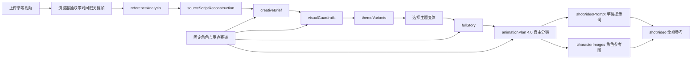

# AI 短视频导演工作流规范

## 1. 产品判断

本工作流不以“和原片越不一样越好”为目标。质量标准由两组同时成立的约束构成：

- 体验保真：同定位、同受众、同核心情绪、同类剧情驱动力、同款高价值桥段。
- 表达原创：具体人物、任务、道具、对白、场面调度和镜头表达重新设计。

抽象母题与具体表达必须分开处理。送达任务、旅途结构、情感媒介、获得帮助、被关爱对象、天气或空间推动情绪、生活化或仪式化结尾属于通用叙事构件，可以继续使用；独特台词、专有名称、罕见动作组合、独特道具组合和逐镜对应才进入禁止复制项。

## 2. 处理流程

「从剧情开始」（2026-10-09）不经过参考视频那一段：用户原文或只有固定角色设定写入 `storySource`。只给角色设定时跑「只看文字的角色边界 → 单个故事候选（服务端签发 `variant:V1`）」两步，再接完整剧情、4.0 自主分镜与视频生成；粘贴完整故事时**不生成候选**，跑「只看文字的角色边界 → 按原文拆出可翻拍镜头（`fullStory:V1`，`V1` 是故事位）」两步，再接 4.0 自主分镜与视频生成。粘贴原文时原文是唯一的剧情依据，台词只能逐字取自原文；不做展开前体检、候选评审/修订、按问题修改与剧情体检。契约见 `docs/story-entry-phase1-2026-10-09.md`。

### 阶段一：referenceAnalysis

必须回答：

- 内容定位、目标受众、故事梗概。
- 主角、配角、人物关系、主角职业或社会身份。
- 被关爱对象的身份、显性需求和隐性需求。
- 对白风格、镜头节奏、情绪曲线。
- 观众为什么愿意看完。

所有关键判断需要引用采样画面编号（F1、F2……）或用户补充文本。无法确认的内容进入 `uncertainties`，不得伪装为事实。

`referenceAnalysis.observedFacts[]` 是结构化视觉证据层。每项只保存一个直接可见 observation、受控 `factType`、`core/supporting` 重要度，以及结构化的 frame 或 video `evidenceRefs`。原生视频证据只使用整数 `startSecond/endSecond`，最大整数结束秒必须严格小于输入视频时长加 1 秒；模型不得输出毫秒字段。完整 `referenceAnalysis` 会作为下一阶段的分析上下文，但人物动机、隐性需求、叙事意义等判断不能冒充画面直接证据。分析结果由服务端签名并绑定当前 transcript、关键帧与原生视频；客户端改写或跨素材复用后必须重新分析。原生视频模式的首次候选若仅以 `VIDEO_EVIDENCE_TIME_INVALID` 失败且已有关键帧，系统丢弃该候选，不回传其 Artifact 或错误子树，改用同一模型和既有关键帧重新执行一次 frames-only 取证；该调用是媒体证据重新获取，不是内容 repair，frames-only 结果仍失败时立即终止。签名前只接受本次实际媒体模式对应的 evidence，不能引用模型本次没有实际收到的视频时间段。

### 阶段二：sourceScriptReconstruction

本阶段恢复为完整可读脚本还原。模型同时接收参考视频或采样画面、`referenceAnalysis`、视频元数据和用户补充字幕，按场输出：

- `timeRange`、`location`、`characters`、`visibleActions`；
- `dialogueGist`、`shotDesign`、`emotionNode`、`dramaticFunction`；
- `turningPoint`、`keyProps`、`sourceEvidence` 与 `confidence`；
- 全片 `coreEventSequence`、`relationshipPattern`、`endingAction`、`turningPoints` 和 `uncertainties`。

“完整还原”指在现有证据范围内覆盖开场、发展、转折和结尾，不等于填满采样间隙。未提供音频转写时，只能概括可确认的对白功能。`sourceEvidence` 继续使用 Reference Analysis 中已有的画面编号、时间码或用户补充文本；无法确认的身份、对白、动作和因果关系必须进入 `uncertainties`。

服务端仍会为 Analysis 和 Reconstruction 附加完整性签名，并将 Reconstruction 与当前素材上下文绑定，防止客户端篡改或跨素材误配。签名只保护通过契约校验的完整脚本，不再把脚本降级为 `sourceFacts`/`factRefs` 引用图；下游 Creative Brief、视觉规则和完整剧情会消费验签后的完整可读字段。

### 阶段三：creativeBrief

**creative_brief/2.0（2026-09-23）起简报只做原片解读**：模型只输出 `storyEngine` 与 `recastTest` 两项，顶层多一个键就以 `CREATIVE_BRIEF_UNEXPECTED_FIELD` 失败；服务端校验通过后盖 `schemaVersion: "creative_brief/2.0"`。提示词只收原片分析与脚本还原，不收固定角色、赛道与创作限制。定位、受众、情绪曲线与观看动力由候选阶段直接从 `referenceAnalysis` 按白名单投影（不取带原片情节的 `emotionCurve.phase/trigger`、`contentPromise`、`whyWatchToEnd`、`retentionDrivers.payoff`），原片表面表达由角色边界阶段从脚本还原 `keyProps` 逐字摘录。依据与回放数据见 `docs/creative-brief-slim-2026-09-23.md`。

简报的两项：

- `storyEngine`：`desire` 欲望、`obstacle` 阻碍、`escalation` 升级、`turningMechanism` 观众理解的转变、`payoff` 回报。2026-09-10 起 `turningMechanism` 是 **`{before, after}` 两个槽位**：`before` 写前半段观众以为这是一段什么关系，`after` 写看完之后重新理解成什么。它**不是剧情转折点**，不是「主角做了什么」，也不是「问题怎么解决的」——那是最自然的误读，提示词明写着点破它。两端必须是对同一组人物关系的两种理解，不能写成「任务没完成 → 任务完成了」或「情绪低落 → 情绪变好」；转变不必是反转，小幅度的重新理解也算。此前这五个子字段**一条定义都没有**，是整份简报里唯一全无说明的子对象，实测三个真实包里一份把它写成了剧情概括。
- `recastTest`：**换个角色来演，什么会塌掉**（2026-09-11）。`{recastAs, collapses, survives}` 三个槽位——先把原片主角换成一个性格完全不同的角色（`recastAs` 必须写出具体性格），再逐场问「这一场换了这个角色还成立吗」：不成立的进 `collapses`（**只有这个角色才给得了的东西**），照样成立的进 `survives`（谁来做都一样）。它与 `storyEngine` **平级而不在其内**——那五个键本身就是一个完整的**事件结构模型**，问 `desire` 必然答「她想要什么」，在里面加定义只会拿到更精确的事件描述；两轮真实回放（3.7-max 与 3.8-max-0902）写出的 `turningMechanism` 质感不同但都停在事件层，换模型不解决。它刻意写成一个**操作**而非定义：`turningMechanism` 加定义后实测 3/3 照抄措辞框架，而本仓库成功的改动全是结构性的、失败的全是措辞性的；举例一律用反例，不给正例。**两侧同时必填是要点**——只填 `collapses` 模型会把所有东西都塞进去，要求同时列 `survives` 它才必须做区分，与 `transformationProof` 拆两个槽位同一个招式。五条闸门全是类型、非空与集合比较（恰好三个键、`recastAs` 非空、两侧各至少 1 条非空、**两侧归一化后不得有交集**、同侧不重复），**判不出 `collapses` 写的是具体动作还是品质词**。只在生成路径生效，旧简报照常加载。候选阶段只拿到 `collapses`，`survives` 不下发——送它是要候选迁移同一性质的东西，不是复现原片那些动作。
  `validateStoryEngine` 挂在 `ensureOutputContract` 的 `creativeBrief` 分支，判定全是类型、非空与字符串比较：四个文本键非空；`turningMechanism` 必须是恰好含 before/after 两个键的对象；两端非空；归一化后 `before !== after`。**闸门只抓「两边写同一句话」这种退化，判不出写出来的转变是不是真发生在关系上。** 它**只在生成路径生效**（该函数全项目只在 `createBrief` 里调用），所以 `turningMechanism` 仍是字符串的旧简报照常加载，浏览器的「理解转变」格对新旧两种形状各有一个分支。

以下是**旧简报（没有 `schemaVersion`）才有的字段**，creative_brief/2.0 已停产，下游也不再按字段读取；旧简报照常加载与导入，不迁移：

- `contentType` / `targetAudience` / `coreEmotion`：定位三项（实测基本逐字抄原片分析）。
- `emotionStructure`：每一阶段的剧作功能与目标情绪。
- `roleAndOccupationMapping`：原片角色功能如何映射到固定角色和赛道身份。
- `reusableHighValueBeats`：桥段价值、必须保留内容和可改变表面。
- `controlledRewriteVariables`：需要受控改写的变量。
- `protectedExpressions`：记录原片具体表达及其来源；字段名保留兼容，但不作为下游正文禁词。
- `minimumTransformationRules`：最低变换规则及验收检查。
- `allowedNarrativeComponents`：七类通用构件的安全复用方式。`component` 由服务端固定为送达任务、旅途结构、情感媒介、获得帮助、被关爱对象、天气或空间推动情绪、生活化或仪式化结尾；Prompt 展开完整七项，模型只填写非空的 `howToReuseSafely`。即使不采用也必须保留分类并说明限制，禁止改名、合并、省略、重复或增加分类。每条 `howToReuseSafely` 必须以 `【原片有】` 或 `【原片没有】` 开头作出存在性判定，缺少前缀时校验失败；判定只陈述原片既有事实，不得用一条针对新片的正向复用指令绕过。`【原片有】` 必须用「」引出上游依据并被回查核对，判据为字符覆盖率 ≥ 0.75，允许转述。
- `nonNegotiableExperience`：五项体验保真要求。

（仅旧简报）`controlledRewriteVariables.sourceValue` 和 `protectedExpressions.sourceExpression` 若列举同类具体物品，每个名称必须重复完整中心名词，例如“绿色邮箱、红色邮箱、蓝色邮箱”，不得缩写为“绿色、红色、蓝色邮箱（组合）”。这项约束只负责完整表达上游已有事实，不得新增物品，也不得由本地语法规则反向猜测旧缩写。`visualGuardrails.sourceSimilarityRules[].sourceExpression` 另有确定性校验：每个并列项必须逐字出现在同一条规则的 `triggerEvidence[].evidence` 中，补全或拼接即 fail closed；保留上游原文是合法退路。

这两类来源字段不会自动禁止下游复用对应表达。原片道具、拟声词和角色组合可以按当前选定剧情出现在 Variant、Legacy Full Story 与 Animation Plan 的任意正向业务字段，包括 `visibleAction`、对白、声音与 `videoPrompt`；但来源上下文本身不是使用指令，不得据此机械注入正向内容。该放行不授权修改固定主角，固定主角的签发身份与外观仍由 `fixedCharacterBoundary` 唯一约束。

### 阶段四：visualGuardrails

`visualGuardrails` 是固定角色语义唯一生成阶段，只负责一次性确定并签发全局角色边界，不负责生成最终图片或视频负面提示词。它同时读取用户角色描述、参考分析与脚本还原（creative_brief/2.0 起不再读简报，原片表面表达的候选短词由服务端从脚本还原 `keyProps` 逐字摘出、带路径给出），并允许视觉模型用通用常识补全用户采用的角色原型；不使用本地物种关键词字典。用户明确肯定或否定的描述优先于模型常识，无法消解的冲突必须进入 `unresolvedConflicts` 并阻断下游。输出必须拆成：

生产环境必须校验 `fixedCharacterBoundary` 的 HMAC 签名。本地 `test`/`development` 只有在服务端同时配置 `WORKFLOW_SIGNATURE_POLICY=test_package_unverified` 时才跳过签名比较，以便服务重启后继续回放测试包；`sourceDigest` 与 `boundaryDigest` 仍然强制校验，不能复用其他素材、用户设定或被改写过的边界。

- `fixedCharacterBoundary.requiredTraits`：后续角色参考、剧情扩写、动画规划和生成请求必须沿用的身份、外观、性格、职业或剧情功能事实；每项带 `explicit | inferred` 证据等级和模型生成的同义词。
- `fixedCharacterBoundary.allowedTraits`：允许按剧情选择使用、但不要求每个角色参考都出现的事实。
- `fixedCharacterBoundary.forbiddenTraits`：与已确定角色形象冲突、后续正向字段不得出现的事实。
- `allowedPositiveTraits` 与 `positivePromptBoundary`：由服务端从上述全局边界确定性派生，模型不得另写第二份角色事实。
- `sourceSimilarityRules`：记录原片表面表达的 provenance，不是下游正文禁词；只有生成请求实际传入原片视觉参考时，相关 evidence 才能在该次请求中为 `reference_leak` 提供依据。
- `dialogueRules`：只记录用户明确提出的角色口癖、可用拟声词或禁用对白；不得从原片对白、拟声词、Creative Brief 来源字段或 `sourceSimilarityRules` 自动生成。

服务端将边界与当前 `creatorProfile`、`referenceAnalysis`、`sourceScriptReconstruction` 和 `creativeBrief` 的摘要绑定并签名。Variants、Legacy Full Story、Animation Plan、人物参考精修、角色图和视频生成只消费验签后的边界，不再解析 `fixedCharacter` 或调用模型常识重算。用户修改角色设定、字幕、参考视频或上游创意数据后，旧边界立即失效并要求重新生成。

`sourceSimilarityRules.sourceExpression` 与相关 evidence 沿用同一完整名称规则。若旧 Brief 或 Visual Guardrails 已签发“绿色、红色、蓝色邮箱组合”这类歧义缩写，系统不得把“红色”自动扩写为“红色邮箱”；必须重新生成对应上游 Artifact 后再进入下游。下游不得把这些来源表达编译成正文黑名单，也不得仅因词面命中而拒绝 Variant、Full Story 或 Animation 正向字段；只有实际传入原片参考时，才能把受信 evidence 用于 `reference_leak` 判断。

该阶段没有 `commonNegativePrompt`，也不维护“未声明身体部件”的完整枚举。未声明不等于禁止；只有全局边界明确写入 `forbiddenTraits` 时，相关概念才参与后续拦截。

### 阶段五：themeVariants / Story Candidates

`themeVariants` 的 wire shape 与 Artifact 名称保持不变，但其中每个 `variants[]` 项按严格 Story Candidate 契约校验。所有对象递归拒绝未知字段；候选继续复用现有任务、压力、剧情节拍、结尾仪式与保真/原创性字段，只新增五个候选级字符串：`keyChoice`、`climax`、`emotionalPayoff`、`novelty`、`visualPotential`。这些字段是选题层摘要，不包含 Full Story、人物圣经、分场、镜头或 Animation Plan 数据。

每个 Story Candidate 必须可独立拍摄，并提供两组验收证据：

- `experienceFidelity`：逐项说明定位、受众、情绪、驱动力和高价值桥段如何保留。
- `transformationProof`：逐项说明人物、任务、细节/道具、对白和视听表达实际发生的改编；不要求每个原片表面表达都必须替换。

只替换姓名或职业不算候选分化。多个候选至少要有两个不同的确定性结构签名；签名只投影 `dramaticFunction` 序列、`keyChoice`、`climax` 和 `emotionalPayoff`，不靠老人、下雨、礼物等题材关键词判断差异。本地校验只检查严格字段、候选 id、Beat 连续编号、固定主角与结构签名，不判断“选择是否有意义”或“情绪是否成立”等纯语义质量。

每个候选至少有一个主要承担角色性格或人物关系质感的 Beat，但该 Beat 仍必须改变关系状态、情绪状态、信息状态或后续选择条件；删除后必须使角色弧线、关系推进、情绪积累或后续因果至少损失一项。候选仍必须产生新的具体任务、环境压力、情感媒介、帮助方式和结尾仪式。

用户明确选择候选时，浏览器把完整 Candidate 提交为 `variant:<id>` Artifact。Full Story 请求必须另带该 Artifact 的精确 `artifactId/revision/contentDigest`；服务端在模型调用前后都从 Run 读取 current Artifact，核对请求副本的 canonical digest，并只把服务端落盘内容交给既有 Full Story 流程。`candidateBinding` 仅是请求 sidecar，不进入 Prompt、Legacy Full Story wire shape 或 Artifact 内容。同一 id 下任一内容变化都会换 digest/revision，旧请求与旧下游不再 current。

页面恢复时，current Full Story 或 Animation Plan 可恢复其 `selectedVariantId`；没有下游时，只有 current `variant:<id>` 明确选择记录才能恢复。仅有 `themeVariants` 时保持 `selectedVariantId = null`，禁止从 `variants[0]` 默认选中。

Phase 2 的预留接缝只是「已签发 Candidate 内容 + 精确 lineage reference」：未来 Blueprint 若实施，必须消费这一对受信输入，不能再只用 id 猜候选。当前没有 Story Selection/Blueprint Artifact、API 或额外 LLM 调用。离线质量基线的输入、结果与人工评分边界见 `docs/story-quality-evaluation.md`。

#### Phase 1.2 候选结构自由度（2026-08-28）

上一轮把候选写得彼此雷同的原因不在模型，而在容器：Schema 强制每个候选必须有 `careRecipient`、`helper`、`emotionalMedium`、`endingRitual`，Prompt 又把 `storyOutline` 固定成 6 拍、相位固定为「钩子、障碍、关键选择、后果、高潮、兑现」，并把 `keyChoice`/`climax`/`emotionalPayoff` 钉死在 Beat 3/5/6。Prompt 一边要求任意两个候选至少三个维度根本不同，容器一边规定它们共用同一套人物功能配置和同一条骨架。本轮解开这两处：

- **可选叙事构件**：上述四个候选级字段与 Full Story 的 `characterBible.careRecipient` 降级为可选键。写了仍必须合规，不需要就整个键省略，禁止空字符串或占位文本。`protagonist` 与固定角色锁定不受影响。Prompt 另加一条批次约束：`count` 个候选里最多 2 个可以同时写出 `careRecipient` 与 `helper`。
- **结构自由度**：`storyOutline` 改为 5–7 拍，候选之间可用不同拍数；`phase` 由候选自己命名以描述该拍的实际职责，**禁止**套用原来那套固定词表，也不得全组共用同一串 `phase`。三个顶层字段仍逐字绑定到某一拍，但落在第几拍由候选自己的因果结构决定，只保留因果序约束：关键选择拍 < 高潮拍 < 最后一拍，且关键选择拍与高潮拍之间至少隔一拍写该选择的直接后果。

- **关键拍号与服务端派生投影**：`keyChoice`/`climax`/`emotionalPayoff` 由服务端从 `storyOutline` 按模型给出的 `keyChoiceBeat`/`climaxBeat` 确定性派生，`emotionalPayoff` 恒取最后一拍。此前要求模型逐字重复长句，实测合规率两极分布（多次 0/12，加强措辞后仍有 2/12 与 9/12），失败模式是模型改写而非复制，且与 Prompt 自身的「顶层不得含准备」规则冲突。派生消除整类失败；可唯一推导的字段由服务端签发、模型回显一律覆盖。校验只裁决拍号范围与「关键选择拍 < 高潮拍」。「高潮拍必须早于最后一拍」曾一并硬裁，实测模型两轮独立采样各产出 2 个「五拍、高潮收尾」候选后移除——那是成立的写法，且两者相同只让 climax 与 emotionalPayoff 取到同一句话，是冗余不是矛盾。该偏好与「两拍之间隔一拍写后果」同属剧作观点，都只留在 Prompt。

三项都只改生成约束与 Schema required 集合，不新增 Schema 字段、不新增模型调用、不新增关键词规则，也不改写已签发的旧 Artifact。旧候选带着这四个字段仍然合法。分化校验同步从「全组完全雷同才失败」收紧为两两比较，并在报错里点名具体是哪一对雷同。

Full Story 阶段同步修掉一处跨阶段契约冲突：该阶段过去把七项 taxonomy 与 Variant 内容并列写成「都必须忠实承接」，与 Creative Brief 阶段「不会把该构件变成每个新方案的必选项」直接矛盾，等于候选阶段省略掉的构件会在下一阶段被补回来。现在承接范围只认当前 Variant 实际写出的内容。同时新增对白质量约束：禁止复述同场 `visibleAction` 已可见的信息，禁止旁白式播报内心。两者都是 Prompt 生成约束，没有确定性校验兜底。

#### 候选因果引擎的主导变量是 creatorProfile，不是 Brief（2026-08-28 实测）

解开模板后仍观察到候选之间因果引擎雷同：四个候选的关键选择都是「放弃某样东西去帮忙」，末拍相位是同一个词。当时的假设是 `creativeBrief` 把原片因果链夹带进了候选阶段——`storyEngine` 已按 Phase 1.1 挡在投影之外，但 `emotionStructure[].function` 与 `reusableHighValueBeats[].dramaticValue` 仍进入投影，且实测有 4/24 条 `dramaticFunction` 逐字复制自这两个字段，而结构分化签名恰恰由 `dramaticFunction` 计算。

**该假设被真实回放否定，因此没有修改 Brief 投影范围。** 对照实验只改 `creatorProfile.fixedCharacter`，其余上游、赛道、模型与提示词全部不变：

| 人设 | 逐字投影 | 末拍相位种类 | 因果引擎 |
| --- | --- | --- | --- |
| 「村里的热心帮手」 | 12/12 | 1 种（四个候选同词） | 四个候选都是「放弃 X 去帮忙 → 被感谢」 |
| 「村里最不爱管闲事的人」 | 12/12 | 4 种 | 突发扑救 / 延迟回响 / 工程式创意 / 表演介入，各不相同 |

关键点：**两次的 `creativeBrief` 都把 A→B→C 完整写在 `emotionStructure` 与 `reusableDramaticValues` 里**（「善举获得外部奖励，情感势能爆发」「将荣誉分享给长辈，升华亲情主题」），而换人设那批四个候选**没有一个**执行转赠长辈。Brief 开着这条路，候选没走。所以 Brief 投影不是收敛主因，收紧它属于改错地方，还会削弱原本正常工作的抽象保真。

原因在 `fixedCharacterBoundary`：它把人设签成必需事实并传给每个下游阶段。「村里的热心帮手」被签成 `scope: storyFunction`——主角的**剧情功能**就是帮手，那么每个候选都是善举是设定要求的结果，不是候选阶段失守。换成「最不爱管闲事」后签成 `scope: personality`，`keyChoice` 随即从「放弃某物去帮忙」变成「决定介入」，每个候选内部因此产生角色弧线，相位名也出现「旁观者状态」「疏离旁观」。

**因此：`creatorProfile.fixedCharacter` 中的剧情功能定位会直接决定候选集的因果引擎。** 调它比调 Prompt 或校验器的杠杆大得多。写死剧情功能（帮手、送信员、照顾者）会让整组候选共享同一个引擎，且这一层无法由下游的反套路约束或结构分化校验挽回——那些约束只能阻止候选**重复**同一条完整因果组合，不能凭空创造出人设不允许的欲望类型。

保留的限制：换人设后四个故事**仍然都是主角帮了别人**，只是入场方式从「默认助人」变成「旁观→介入」。人设词改变的是进入冲突的方式，不取消助人本身。另外该实验只覆盖候选阶段，没有回放到 Full Story 与 Animation Plan。

#### Phase 1.1 回放结论与 Phase 2 边界

真实生产包回放表明，严格字段和确定性结构签名通过，不等于候选已经在语义层形成不同故事。`creativeBrief` 是抽象层，但历史 Artifact 可能把原片的具体动作、道具解法、分享方式和告别顺序写进 `storyEngine`、`reusableHighValueBeats.mustRetain` 或 `nonNegotiableExperience`；下游 Variants 随后可能只替换道具和措辞，却共享同一条「目标 → 压力 → 机智解法 → 成果分享 → 告别」因果链。Phase 1.1 同时校准 Brief Prompt 与 Variants Prompt：新 Brief 的强保真字段只能写抽象剧作价值；Variants 只展开定位、受众、核心情绪、情绪结构和 `reusableHighValueBeats[].dramaticValue` 的安全投影，不展开历史 `storyEngine`、具体 Beat/`mustRetain`、`samePlotDriver`、`sameBeatValue` 或 `creativeDistancePolicy` 值。这个投影不会原地改写已签发旧 Brief，也不新增 Schema 字段、deterministic validator、模型调用或关键词规则。

候选批次的**语义差异**与当前确定性**文本签名差异**不是同一个保证。现有校验证明**任意两个** Candidate 在 `dramaticFunction` 序列、`keyChoice`、`climax`、`emotionalPayoff` 的 canonical 文本投影上都不同（2026-08-28 从「全组完全雷同才失败」收紧为两两比较——旧口径让「4 个候选里 3 个雷同」合法通过，等于 Prompt 的分化要求没有执行力）；它不能证明危机、选择成本、因果结构或情绪兑现实质不同。老人、雨、礼物、毛线球等题材词不能成为本地分化判据。批次级语义分化、选择是否有意义、Beat 是否必要和情绪是否成立，仍属于离线人工评测或未来 Phase 2 的窄语义评审职责。

Prompt 中关于施动性、因果、人物质感、悬念、承诺和连贯性的要求，目前只是生成约束，不是已落地的内容正确性证明。`keyChoice`/关键选择拍、`climax`/高潮拍、`emotionalPayoff`/最后一拍的逐字投影，以及 `highValueBeatMapping.newExpression` 对 `storyOutline` 正文的逐字投影，可以消除候选内部的多版本事实，却不能证明这些事实在现实语义上成立；真实 5×4 回放仍由人工发现同一物品重复分配、动作先后回退等问题。Candidate digest/revision 绑定也只证明 Full Story 使用了哪份 current Candidate，不证明 Full Story 或 Animation Plan 的自由文本在语义上完整、无重复、无跳接或无角色外观漂移。Phase 1.1 发现的三条具体下游失败样本只登记在 `docs/GitHub-Benchmark-后续改造待办.md` 的 T09，本轮不修改 Legacy Full Story、Animation Plan、partial repair 权限或最终 wire shape。

#### 原片事实溯源（2026-09-06）

`transformationProof` 的五个 `changed*` 保持 `{source, replacement}`：`source` 只记原片，`replacement` 只记本片。2026-09-09 起，有两份原片上游的生成路径先独立选择来源，再创作候选；选源输入只有冻结的 `referenceAnalysis` 与 `sourceScriptReconstruction`，不含新角色、Brief、Guardrails、候选或 replacement。模型只选人物、事件、对白、画面四维的目录 ID，非空、已知且不重复，不设人为的 4 条上限。服务端复制完整原文；引用 `dialogueGist` 时一同复制同场画面上下文，避免把黑屏字幕记录单独变成台词。道具直接来自全部 `scenes[].keyProps`，仅按精确文本去重；合法空清单签发“原片没有可引用的场次道具清单记录”，只声明清单为空，不声称画面没有物件。

来源目录和派生值仅留在本次服务端私有上下文，候选模型只输出五个 `replacement`。服务端只覆盖已有五对字段的 `source`，不补缺失维度、不修改正文或其他字段，再执行完整候选校验。一个 variants Task 使用创建时的同一 provider/model 顺序调用两次、只提交一次 themeVariants，冻结四份上游直接依赖；任一调用失败即结束，不循环重试。两次调用沿用现有 watchdog、冲突检查与用量汇总，选源日志 scope 为 `variantSourceBaseline`，不新增中间 Artifact、Task 类型或业务 JSON 字段。旧调用点和已签发候选的来源校验仍保留字符覆盖率及 `原片没有` 前缀兼容。

这保证引用可追溯和新角色输入隔离，不保证上游描述本身正确或模型选到了每个相关事实。原片转写中字幕/人声不明、外观缺失或动作矛盾不能由选源程序猜测修复。Full Story 承接候选正文与 replacement；source 仅作原片对照，不成为本片增补要求。

缺席声明按**前缀**判定：第一版要求精确等于四个字，实测 20/20 全部失败（模型一律把它当句子开头补完）。否定句不制造改写基线，因此放宽到前缀不削弱这条闸门；正向声称仍逐条核对。同批实测还暴露模型会把 `source` 的提问方向写反（回答「原片有没有我要加的东西」而不是「原片这一维度有什么」），提示词已改为正向引用优先并给出填好的样例，但**这一条没有确定性兜底**。

`highValueBeatMapping[]` 新增必填 `failureSignal`：这条保留机制没有迁移成功时会长成什么样。只有 schema 形状校验，没有语义兜底。

#### 候选对照评审（storyCandidateReview，2026-09-06）

`POST /api/story-candidate-review`。与剧情体检同规格：**只出报告**，不修改候选、不签发 Artifact、不进 lineage、不参与派生、不 stale 任何东西、不改变候选数量、不阻断后续 Full Story；手动触发，刷新页面即失。

送审投影按**允许清单**构造：只送 id、title、hook、logline、`narrativeMode`、`characterSetup`、`storyOutline` 动作链、`keyDialogueDirections` 与 `failureSignal`，剥掉 `novelty`、`visualPotential`、`experienceFidelity`、`transformationProof`、`originalityRiskCheck`、`retainedValue` 以及每拍 `dramaticFunction`——它们是生成者的自我解释与意图标签，送进去等于让解释替故事过关。`failureSignal` 是证伪条件而非成功声明，因此保留。

覆盖率确定性核验：候选数量相等且 `candidateId` 逐位相同、`title` 回显必须包含原文、`beatIndexes` 必须在该候选拍数范围内、`recommendedOrder` 必须是全部候选 id 的一个排列；核验通过后用原文覆盖 `title`。不打总分；`verdict: drop` 只是报告结论，不删候选也不触发任何 stale。「判得对不对」是语义判断，没有确定性兜底。

**因果自洽检查 `coherenceChecks`（2026-09-09）**：`candidateCheck` 的必填数组（空数组合法），每条写 `kind` / `beatIndexes` / `problem`。`kind` 五个取值全部来自实际观察到的失败形状：`contradiction` 同一候选两处描述互相否定、`tool_misuse` 手上已有能解决问题的东西却用更差的替代物、`purpose_nullified` 任务目的被链条里另一件事当场抵消、`space_or_time` 前面说够不到或来不及后面用更弱的办法却成了、`other`。闸门只有一条且是纯枚举比较：**`coherenceChecks` 非空就不能判 `pass`**，诊断码 `STORY_CANDIDATE_REVIEW_PASS_WITH_COHERENCE_BREAK`；它不裁决那条自洽问题成不成立。拍号合法性与 `mechanismChecks` 共用同一份 `checkBeats`。它查的是「呈现 vs 呈现」，与剧情体检的「声明 vs 呈现」不是同一件事。**命中率实测 38%（四个包 16 个候选报出 6 个），绝不是完备闸门**——已知有 3 处矛盾的那个候选只被抓到 1 处；`verdict` 与 `recommendedOrder` 在包与包之间不稳，不得当成自动选择依据。

**原片机制清单 `sourceMechanisms`（2026-09-09）**：**顶层**必填数组，schema 限定 **2–4 条**，每条 `{id, mechanism, whereInSource}`；`mechanismCheck` 用 `sourceMechanismId` 按 id 引用，不再各自重写机制正文与原片位置。闸门两条，都是纯集合成员比较：id 必须唯一（`CANDIDATE_REVIEW_DUPLICATE_MECHANISM`）、每个引用必须在清单里（`CANDIDATE_REVIEW_UNKNOWN_MECHANISM`）。它修的是循环论证：旧契约下四个包里三个各自提炼出 **8–9 条**「原片机制」、每条都照着那个候选本身写，于是 6/8 判 `depicted`；上限 4 条之后「4 个候选写出 8 条互不相同的原片机制」在构造上不再可能。提示词同步改口径——先只读原片写出清单（在看任何候选之前），再逐个候选核对命中哪一条，自检方法是「把全部候选删掉，你写的这几条应该一字不变」。**「那份清单读没读对原片」仍然没有确定性兜底。**

浏览器把顶层清单置顶显示，逐条 `mechanismCheck` 旁显示它引用的那条机制正文，`coherenceChecks` 单独成块并把 `kind` 译成中文；顶部摘要按 §2.13 同规格**数出**因果断裂条数与涉及候选数，不问模型要总分。旧报告没有这两个键时那两段整段不显示——数出来的 0 是「这一档还不存在」，不是「查过了没问题」。

**带诊断的重试（2026-09-10）**：这一档从 `generateStageJson` 改走 `modelCallCoordinator.runJson`，`maxProviderCalls: 2`，**禁止第三次**。被确定性闸门拦下时，把校验器数出来的 `path / reason / code` 追加在原提示词末尾重做一次；**不把失败的报告发回去**（第二次请求只发 diagnostics 是本仓库对有界纠错的一贯纪律，何况提示词本身已含全部候选投影与原片动作稿），没有结构化诊断时退回原提示词。**校验逐字不变**——改的是「错了之后怎么办」，不是「什么算错」。

返回值多一个 `metadata.storyCandidateReview`（`provider` / `model` / `providerCalls` / `rejections`）：**服务端拦过一次就必须说出来**，浏览器在报告顶部以 warn 色显示第几次调用、第一次被什么拦下。`providerCalls` 由 `attemptObserver` 计数而非从「有没有被拦」反推——传输失败时供应商确实被调用了两次却没有诊断。两次都被拦即 fail closed，**两次的诊断都在响应里**并各带 `attempt` 序号。走 coordinator 就拿不到 `generateValidatedJson` 自带的模型输出侧车，必须自己接 `attemptObserver`，否则静默不写。

依据是 2026-09-10 的真实回放：同一个模型、两份合法候选，一份一次写全 `recommendedOrder`，另一份只写了 1 个 id 被判失败，整份两千字报告连同 ¥0.27 一起丢弃，而模型自己不知道漏了什么。**它救不了语义错误**——机制清单读错原片、自洽问题判错都不产生诊断，也就不触发重试；它只把这一类「漏抄几个 id」的失败从 502 变成重做一次，不提高判断质量，更不改变候选本身。其余八个走 `generateValidatedJson` 的阶段逐字不受影响。

评审响应是 `{ review, metadata }` **两层**：`metadata` 记 provider / model / 实际调用次数 / 每一次被拦的诊断，**不混进 `review` 对象**——`storyCandidateReview` 的 schema 是 `additionalProperties: false`，混进去这份报告就送不回服务端，而下面的定向修订正要拿它当输入。

#### 命题定向修订（storyCandidateRevision，2026-09-10）

`POST /api/story-candidate-revision`。对照评审只出报告、不改命题，这一档才是唯一会改动命题正文的地方——但它同样**只出候选、不签发任何东西**：不写回 `themeVariants`、不进 lineage、不 stale。签发只发生在用户在浏览器点「采纳」的那一刻。

**驱动信号是逐条锚定的那两类，不是 `verdict`。** 依据是同一份命题三次回放的实测：`verdict` 与 `recommendedOrder` 每次都不同（2 pass/2 revise → 2 revise/2 drop → 2 revise/2 drop），而两个信号都逐条锚定。**一次只修一个命题**：最终只有一个会被展开成 Full Story。

两个信号的修法不同，提示词里分块列、各写各的修法：`coherenceChecks` 是「因果说不通」，**必须修**，基本都能靠改写解掉；`mechanismChecks` 里判 `not_depicted` / `partially_depicted` 的是「原片有、这个命题没接住的机制」，**由修订模型判断该不该接**，接就必须先从现有动作链里拿掉一个分量相当的（一换一）。机制正文由 `candidateUnmigratedMechanisms` 按 id 从顶层 `sourceMechanisms` 查回来一并送出，查不到整条丢弃。

第二个信号是 2026-09-11 补的，依据是实测：V4 被判 drop 的主因是三条机制全部 `not_depicted`，评审 summary 也写着「最该先改的是补充转赠长辈的动作」，而修订当时只收到那条最轻的空间断裂，于是只把「小木箱」换成了「高脚木凳」。**接机制必须有拒绝出口**——原片有那条机制不等于这个命题必须去接，与立意冲突时模型要明确拒绝并在 `changeSummary` 写明理由，与「`verdict: drop` 只是一句话」同规格。「不要靠加戏」因此升为两类共用的铁律，宽严不同而不是二选一：两条硬约束互相矛盾时模型只会随机选一条。

可写范围分三档。**可写**：`storyOutline[].action` / `emotion` / `estimatedSeconds`、`keyDialogueDirections`、`newTask`、`environmentPressure`、`logline`。**派生或签发、出现即拒**：`keyChoice` / `climax` / `emotionalPayoff`（服务端从 action 与拍号派生）、`transformationProof`（`source` 由冻结证据目录签发）。**冻结**：`id` / `title` / `oneLineHook` / `verticalFit` / `narrativeMode` / `characterSetup` / `keyChoiceBeat` / `climaxBeat`、每拍的 `beat` / `phase` / `dramaticFunction`，以及全部自我评价字段。`newTask` / `environmentPressure` 可写是因为实测三条断裂里两条的根在任务设定；`dramaticFunction` 冻结是因为它是结构分化签名的输入；`title` 冻结是为了让人始终能认出是同一个命题。

模型按 `beat` 号**只覆盖、不增删**，且只列真正改了的拍——拍集合因此由构造保持不变，两个拍号永远指得对。服务端在克隆上合并，先证明可写范围之外逐字节不变（此时三个投影还是原值，正好证明模型没绕过派生字段不可写），再重新派生并跑完整的 `ensureOutputContract` + `ensureThemeVariantsMatchProfile`。**不传 upstream**（`source` 逐字未变），**固定角色边界照常验签并复验**。提示词只带目标命题这一个，不带同批其余命题、不带原片、不带 verdict；唯一与评审投影相反的是 `dramaticFunction` 要送——不能改但必须看得到。走 coordinator、预算 2 次、禁止第三次。

**采纳的代价是整批的**：`themeVariants` 是一份 Artifact，签发新版本会递归 stale 这一批全部命题的下游，哪怕别的命题一个字没改。浏览器采纳前列出全部会失效的下游并明确征求同意。修订最省的用法是在选中命题之前。

**三条没有确定性兜底**：执行者反转；一换一但复杂度暴涨（本版刻意不设动作数量台账，改为并排展示并数出动作链字数）；以及 `dramaticFunction` 名义还在、实际已不成立。

### 阶段六：fullStory

用户选择一个 `themeVariants.variants[]` 后，进入独立完整剧情页。该阶段不重新发散主题，只围绕被选中的主题变体扩写，输出：

- `characterBible`：锁定固定角色、对白规则，以及本片实际存在的配角。`protagonist` 与 `helpers` 必填（`helpers` 可为 `[]`），`careRecipient` 是**可选键**——当前 Variant 没有被照料对象时整个省略，不输出空对象或占位文本；输出时五个子字段必须齐全。Full Story 不得把候选阶段省略的被照料对象、帮助者、情感媒介或仪式结尾补回来。
- `beatSheet`：45–90 秒短视频的完整剧情节拍。
- `sceneScript`：可拍摄分场，包含地点、人物、可见动作、对白、镜头/声音、情绪节点和剧作功能。`characters` 只写本场实际出镜角色，数组必填但允许空数组——无人出镜的空镜（雨水、道具特写、建立镜头、人物离开后的空镜、纯转场环境镜头）正确值就是 `[]`，整片则至少要有一个场次非空，否则抛 `FULL_STORY_NO_VISIBLE_CHARACTER_SCENE`。可选的 `offscreenSoundSources` 登记只以声音出现、明确不出镜的角色名。`shotAndSound` 同时承载画面描述与声音来源，程序不得靠正则或关键词区分，因此扫描按字段职责分档：`visibleAction` 只认 `characters`，`shotAndSound` 认两者并集。登记只豁免 `shotAndSound`、绝不豁免 `visibleAction`，所以无法靠登记声源隐藏出镜角色；同名同时出现在两个字段时明确失败不选边；`dialogue[].speaker` 仍必须逐字存在于同场 `characters`。
- `keyProps`、`shootingPlan`、`retentionPlan`：进入拍摄筹备需要的道具、场景和完播设计。
- `experienceFidelity` 与 `transformationProof`：继续证明同定位、同受众、同情绪、同类驱动力、同款高价值桥段，并记录实际发生的具体改编；复用某个来源表达本身不构成失败。
- `continuityAndSafetyCheck`：确认固定主角服从签发边界且剧情连续；不得把 `protectedExpressions` 的词面复用本身判为失败。

完整剧情阶段可单独切换文本模型：默认路由由现有 Qwen/MiMo 配置决定（`DEFAULT_LLM_PROVIDER` 可显式指定 Qwen 或 MiMo）；配置 `DEEPSEEK_API_KEY` 后，页面可以显式选择 `deepseek-v4-flash` 或 `deepseek-v4-pro`。DeepSeek 不自动接管默认路由，不允许用于任何带图片或视频输入的阶段。

#### Legacy Full Story 有界子树纠错

首次模型 completion 已解析为完整 JSON 对象，且全部结构化 diagnostics 都精确指向 `/characterBible/protagonist/name` 的 required/type/empty-string 错误、当前验签固定角色边界提供唯一姓名时，唯一一次 retry 使用内部 `full_story_partial_repair/1.0` 协议。服务端只发送 protagonist 的 `currentValue`、diagnostics、`mutableFields:["name"]`、`expectedFields.name`，以及最小只读的固定角色名、标准角色名、Variant ID 和 sceneId 列表；不发送完整失败 Story，也不重复原始完整生成 Prompt。任何未知正文或其他字段错误都不得签发 Full Story 计划。

服务端为目标签发固定 `repairId`、原候选 `baseDigest`、authorityDigest 和仅当前进程持有的私有计划身份；计划的序列化副本不能用于合并。模型只能返回一个 `{repairId,replacement}`；不能选择 path、返回 patch、删除其他字段或增加 operation。replacement 是 protagonist 对象的完整值，但 `name` 必须逐字等于 `expectedFields.name`，对象内其余已有合法字段和所有目标外数据必须保持不变。

服务端在原候选 clone 上原子合并，验证私有计划身份、候选摘要、当前权威摘要、协议、目标内变更边界与目标外摘要，再从头执行 Legacy exact JSON Schema、Scene Contract、固定角色/Profile 和 Variant 全链校验。初轮生成阶段固定为 primary + 最多一次 retry/repair；第二次仍失败时不得进入后述 Beat–Scene postpass。除上述 protagonist `name` 安全子集外，其他角色姓名或身份字段缺失/错误、`characters` 与 `visibleAction`/`dialogue` 的跨字段冲突，以及没有签发值来源的必填剧情字段都直接失败；不得让 replacement 通过角色改名、删除动作/对白或另编剧情来消除错误。截断、JSON 语法或供应商协议错误因为没有可合并 candidate，仍使用既有 completion retry；已解析但路径不可信、details 为空、目标不存在或整项内容丢失时明确失败，不能静默发送完整 Story 重写。该机制是模型局部重生成，不是本地确定性搬字段、独立语义审计或 Full Story v2。

#### Legacy Full Story Beat–Scene 提交前复核

初轮候选（包括实际发生的唯一允许 retry 或 protagonist `name` 局部纠错）只有在通过 Legacy exact JSON Schema、Scene Contract、固定角色/Profile、Variant 与既有语义边界的完整校验后，才能在 Artifact commit 前进入一次独立的 Beat–Scene AI postpass。它沿用本次 Full Story 明确选择的文本 provider/model；请求的业务内容严格只有完整、已合法的 Full Story JSON 和专用复核提示，不再发送 `creatorProfile`、Theme Variant、Creative Brief、Visual Guardrails、`referenceAnalysis`、Reconstruction、原片边界或其他上游数据。该调用不是失败候选 recovery，也不能作为第二份权威来源。

postpass 把 `beatSheet` 当作只读叙事目标，仅检查现有 `sceneScript` 是否遗漏会造成可拍叙事明显断裂的重要节拍、可见结果、状态变化或因果过渡。没有明显遗漏时返回 unchanged；存在遗漏时，模型不得自由生成 append suffix。每条提议必须绑定已有 scene 和唯一 `beatIndex`，其 `addition` 必须是对应 `beatSheet[beatIndex].storyAction` 的一段连续、逐字相同原文，并且包含该 review 逐字返回的 `beatEvidence`。全部证据只能使用该 `storyAction` 与目标/相关场次当前 `visibleAction` 的逐字 excerpt；不得引用其他 Story 字段、上游数据或模型常识。无法从 `storyAction` 连续逐字投影所需内容时必须返回 `blocked`，不能释义、改写或拼接多个不连续片段。

服务端最多接受 3 个已有目标场次；每条 `addition` 最多 600 字，全部 additions 合计最多 1200 字。合并时只把受信 `addition` append 到对应 `sceneScript[i].visibleAction`，原字符串必须仍是逐字前缀。场次数量与顺序、`sceneId`、`timeRange`、`location`、`characters`、`offscreenSoundSources`、`dialogue`、`shotAndSound`、`emotionNode`、`dramaticFunction`、`shootingNotes` 以及 `sceneScript` 外的所有字段逐字冻结。合法省略、蒙太奇概括、末项代表整组或既有终态已经提供证据时不得重复投影；超限、`beatIndex`/`beatEvidence` 错绑、addition 未包含 `beatEvidence` 或非对应连续原文，以及新增场次、改角色、改对白、改地点或重写原动作都属于协议错误。

正常路径是 primary + postpass，共 2 次 provider call；初轮消耗唯一允许的 retry/repair 后才成功时，再执行 postpass，整个 Full Story operation 最多 3 次，禁止第四次调用。postpass 返回 `blocked`、协议错误、供应商错误、额外字段、越界 diff、非追加式变化或最终完整复验失败时一律 fail closed：不把初轮候选保存为 fallback，不追加另一轮 postpass，也不回退整包重写。服务端只在 clone 上合并已验证为对应 `storyAction` 连续逐字原文的 `addition`，并从头执行 Full Story 全部校验；最终 unchanged 或合法 append 的 Story 只提交一次 Artifact。初轮候选、postpass 响应和合并中间态均不创建 Artifact revision、Checkpoint 或第二份 Story。

#### 当前主流程的有界纠错

局部纠错现在只有上面 Full Story 的专用子树协议。原 `artifact_partial_repair/1.0`（Animation Foundation 固定角色参考）与逐镜语义 Prompt 审计修复已于 2026-10-11 随旧 3.0 分镜删除，不得重新引入。

任何已经解析但没有 adapter/可信 target 的内容错误都 fail closed，不发起第二次整包生成；repair 协议、authority、replacement 或完整复验失败同样终止。内容 repair 最多 primary + 一次局部调用。上述 `referenceAnalysis` frames-only 再取证是丢弃失败候选后的媒体证据重取，不是 repair。供应商/网络错误、签名或 lineage 冲突不是内容纠错，不能走该协议。

4.0 自主分镜不做局部纠错：每一步被结构、来源、时间或角色校验拦下时，把校验器给出的结构化诊断追加在原提示词后重做一次（不发回失败的输出），每步最多 2 次 provider 调用，第二次仍失败即 fail closed。

#### 有界局部纠错 Debug sidecar

只有 stage adapter 已成功签发 repair plan 时，服务端与 `run:video` 才在 `debug/partial-repairs/<UTC>-<stage>-<UUID>/` 建立一次观测 session，并在第二次 provider call 之前完成前两项写入：

1. `01-trigger.json`：原始错误、结构化 diagnostics、签发 target 的 currentValue、最小 authority 和摘要；
2. `02-repair-prompt.txt`：实际发送的局部 repair Prompt；
3. `03-model-response.json`：收到的 replacement 最小投影，额外字段只记录字段名而不记录值；
4. `04-result.json`：当前 repair adapter 完成合并/阶段复验后的 `repaired | rejected` 结论和脱敏拒绝原因；`repaired` 不代表 Artifact 已经提交。

Plan 为 `null`、错误不可定位、候选不完整或属于 transport/lineage 问题时不创建该目录。记录器不得接收完整 Story/Animation Plan 或原始 HTTP 响应，并递归脱敏 Header、密钥、Cookie、签名、Data URL 与 Base64 媒体。目录和文件使用私有权限与原子写入；单次写入失败只产生脱敏告警，不能覆盖业务错误、改变调用预算、补发模型请求或 fallback 保存 raw。`PARTIAL_REPAIR_DEBUG_DIR` 只能改变本地落盘目录，不能改变 repair 策略。

#### Full Story 全量模型输出 sidecar

Full Story 的完整 completion 观测与上述 repair Debug 是两套互斥职责的记录器。只有服务端环境显式配置 `FULL_STORY_MODEL_OUTPUT_LOG_DIR` 时，`ModelCallCoordinator` 才为 Full Story 的每个 primary、实际 retry/repair 与 Beat–Scene postpass attempt 按阶段原样保存 `completion.content`，不复用会按 256 KiB 截断且 30 分钟过期的 AttemptStore。日志不保存输入 Prompt、供应商 HTTP envelope、Header、密钥、Cookie 或任何媒体。浏览器把已有 Production request token 放在旁路 Header；服务端按 `projectId/runId/fullStory:<variantId>/requestId/expectedCurrentRevision` 核对 current running stage 后才标记为 verified，并明确区分 production requestId 与 provider requestId。无 Header 的直接 API 调用可记录为 unbound，但不得搜索其他 Run 猜归属。

每个 attempt 使用私有目录与文件权限、临时文件加原子 rename，日志 metadata 以明确的 `stage` 保存 primary、retry/repair 或 Beat–Scene postpass 阶段，并记录模型、状态、时间、字节数与 SHA-256；模型正文不截断。配置路径位于 `public/` 时禁用。任何验证上下文或写盘错误都只能产生脱敏告警，不得影响 Story Prompt、输出校验、重试/repair/postpass 次数、HTTP 结果或 Artifact commit。全量日志不会写入 manifest、Artifact、Checkpoint、包或导出 JSON，也不能用于恢复/合并失败 Story；它只证明某次模型 completion 实际包含什么文本，不能单凭词命中判定该文本是正向剧情还是负向规避说明。

#### Animation Plan 全量模型输出 sidecar

只有服务端显式配置 `ANIMATION_PLAN_MODEL_OUTPUT_LOG_DIR` 时，`/api/animation-plan` 才在当前异步请求上下文内观测真实 `/chat/completions` 响应。响应克隆只在内存中解析，落盘内容严格限于 `choices[0].message.content`、finish reason、数值 usage、provider requestId、模型名和调用顺序/阶段标签；原 HTTP envelope、请求体、Prompt、Header、密钥和媒体不得落盘。output-only 模式不会创建现有 Animation Prompt 抓取文件。

浏览器沿用 Production request Header；服务端只有在 `projectId/runId/animationPlan:<variantId>/requestId/expectedCurrentRevision` 与 current running stage 完全一致时才标记 verified。缺失或不匹配时可写 unbound 日志，但不得猜测归属或影响生成。现在可观测 4.0 分镜各步（角色事实整理、设计、审阅、修订、终审复查）与单镜提示词的 completion；未进入的步骤没有日志。每条 `model-output.txt` 是 provider 原始 completion 文本，不是 parsed candidate、Artifact 或事实源；观测、克隆、解析或写盘失败均 fail-open，validator、调用预算、repair 决策、错误文字和 Plan commit 必须保持不变。

### 阶段七：animationPlan（4.0 自主分镜）

完整剧情生成后，生成用于 AI 视频制作的 `animationPlan`。**只支持 4.0 自主分镜**：请求必须带 `animationPlanVersion: "4.0"`，输出 `promptSchemaVersion: "4.0"`、`productionStrategy.format: "storyboard_video"`；缺省或其他版本在调用模型前 400（`code: ANIMATION_PLAN_VERSION_UNSUPPORTED`；剧情 Run 先被剧情入口拦下，`code: STORY_ENTRY_PLAN_VERSION_UNSUPPORTED`）。实现与回放证据见 `docs/animation-storyboard-implementation-2026-09-21.md`。

输入只有完整 Full Story、角色事实、画幅、时长窗口、赛道风格（`creatorProfile.vertical`）、画风（`artStyle`，填了才有）、背景音乐开关，以及服务端仍接受的 `characterExpressionRules`（页面已不发）。完整上游仍参与冻结与验签，但不进分镜创作提示词。旧剧情缺配角事实时先单独整理一次角色事实，只为本次 Plan 使用，不改写、不重签 Full Story。

生成最多四步，每步最多 2 次 provider 调用（带诊断重试一次），第二次仍失败即 fail closed：

1. 设计分镜：模型自定片段与时间，可合并相邻场次；每段整数 4–15 秒，总长落在共享时长窗口内；每段由时间连续、覆盖整段的 beats 组成（景别、机位、可见动作、对白、声音）。
2. 审阅分镜：只找明确矛盾或会影响关键理解的缺口，每条问题逐字引用原文；不打分，语义意见不阻断。
3. 按问题修订（审阅报出问题时）：服务端逐条原子合并，不得改变片段时长、beat 结构、角色名单、说话人与来源。
4. 终审复查（修订实际改动了内容时）。

服务端签发 `shotId`（`A01`…连续编号）、`productionStrategy`（画幅、目标时长、背景音乐、赛道风格、画风、表情规则、场次与角色名单）与 `characterReferencePrompts`。签发前完整校验：字段与版本、角色全集覆盖、来源场次只能引用本剧情场次、只有首段是 `start`、beat 时间连续并覆盖整段、`onscreen` 说话人必须在本 beat 出镜、每个剧情场次要么被某段承接要么在 `adaptations` 里说明省略、总时长在窗口内。演示模式用确定性 mock 设计，不做审阅与修订。

Plan 不含 `videoPrompt`。用户点某一镜的生成按钮时才创建 `shotVideoPrompt` 任务写这一镜的提示词：独立 Artifact `shotVideoPrompt:<variantId>:<shotId>`，依赖 current Plan，绑定 Plan digest 与视频/写稿模型配置。校验三条：对白逐字保留；关闭背景音乐时以「全片无背景音乐，只保留现场环境声与动作声。」逐字收尾；Plan 签发了画风时逐字写出画风。用户可以查看、编辑、重新生成，确认后才调用视频。

画幅只允许 `9:16` / `16:9`，生成时锁入 `productionStrategy.targetAspectRatio`；页面「设定创作宇宙」里的画幅只是新 Plan 的默认值。已有 Plan 时拨动背景音乐开关必须重新生成整个 Plan，页面先征求同意。

#### 旧版分镜（2026-10-11 起不再支持）

旧 2.0（首尾帧）与 3.0（direct_shot）Plan 不再打开。判定只有一份：`public/storyboard-plan.js` 的 `legacyAnimationPlanVersion` / `legacyAnimationPlanMessage` / `ANIMATION_PLAN_VERSION_UNSUPPORTED`。

- 生成：只接受 4.0，其他 400。
- 契约：`ensureOutputContract(_, "animationPlan")` 对非 4.0 抛 `OutputContractError`。这是函数级契约，目前没有生产调用者（4.0 生成直接用 `ensureStoryboardPlan`），线上生效的拦截是生成、服务端消费与提交口。
- 服务端消费：读 Plan 的任务与路由（镜头视频、单镜提示词、角色参考精修与出图等）遇到旧 Plan → 409。
- 提交：通用提交口拒收非 4.0 的 `animationPlan` 与新的 `shotFrame:*`。
- 测试包：封装与导入都拒绝旧分镜（400），导入在建 Run 之前拒绝。
- 页面：旧 Plan 显示「这是旧版 X 分镜，已不再支持（只支持 4.0 自主分镜）。请重新生成分镜。」与「重新生成分镜」按钮；旧 Run 里的 `shotFrame:*` 不再读取。

错误码：参考视频 Run 的生成、契约、服务端消费、提交口拒收旧 `animationPlan`、3.0 测试包的封装与导入，都是 `ANIMATION_PLAN_VERSION_UNSUPPORTED`。三处例外：剧情 Run 生成分镜时版本不是 4.0，先被剧情入口拦下（400 `STORY_ENTRY_PLAN_VERSION_UNSUPPORTED`）；剧情 Run 的 3.1 测试包里分镜不是 4.0（400 `PRODUCTION_PACKAGE_PLAN_VARIANT_MISMATCH`）；提交新的 `shotFrame:*` 产物（400 `SHOT_FRAME_ARTIFACT_UNSUPPORTED`）。不迁移、不自动升级旧 Plan。

#### 交付与镜头视频

剧情页提供 JSON 导出：当前测试/规划包版本为 `3.0`（「从剧情开始」的 Run 为 `3.1`）。服务端只对当前 Variant、Full Story 和可选 Animation Plan 的一致 lineage 签发摘要与本机 HMAC；导入先验证 package type/version/digest/signature/parent lineage，再建立隔离的新 Run，禁止与当前浏览器状态合并，且不信任包内旧媒体选择。包里不带单镜提示词缓存，导入后点镜头时重新编写。

页面内保留单镜头试片链路。`POST /api/generate-shot-video` 一律要求当前 Animation Plan 的 production context；服务端从该 Plan 的 `shotPlan[]` 唯一解析 `shotId`，忽略客户端自报的动作、时长和场景，不能降级到无 lineage 的全局目录。弹窗允许编辑的视频提示词通过独立 `promptOverride` 传入，属于当前媒体请求的显式运行时覆盖，回执记录 `videoPromptSource` 与实际提示词；它不反向修改 Plan 的其他镜头事实。生成分辨率（2026-10-10）同样是运行时字段 `resolution`：只能取所选视频模型在 `public/shot-video-resolutions.js` 里的值，没选时按供应商配置；不在清单里、模型没有这个参数、或配置的默认值不适用于所选模型都在建任务前明确失败；它不是 Plan 字段，不进提示词，每条候选记录实际请求的分辨率与 ffprobe 实测宽高。

`generationMode` 是模式权威字段，只接受 `all_reference`；其他值（包括已删除的 `first_last_frame`）明确失败，不静默改写。供应商只有 Seedance 2.0 与 MiniMax H3，默认 Seedance。请求中的 `referenceAssets[]` 是用户与角色参考素材的权威来源；可选的 `continuityReferenceMode` 只允许 `none | previous_shot_frames`，不能反向推断或改变 `generationMode`。4.0 只有 `transitionIn.type` 为 `continuous` 的片段默认请求上一镜抽帧，首段、硬切与时间省略不默认继承。选择 `previous_shot_frames` 时，“上一镜”只能由当前签发 Plan 的 `shotPlan[]` 紧邻前项确定，服务端再从其 current `shotVideo:<variantId>:<shotId>` Artifact 读取当前选中候选，拒绝客户端自报的绝对路径、远程 URL、旧 namespace 或非相邻 shot。服务端用 FFmpeg 按 `t = 时长×i/4` 均匀截取 5 张 JPEG（首帧、末帧和中间三等分点，末帧回退 0.1 秒保证可解码），作为普通 `reference_image` 追加；张数固定不随时长变化，时间戳由 `previousShotFrameTimestamps()` 确定性计算并逐帧写进回执。

这里的权威优先级按职责而不是按“文字更长”决定：当前签发的 Full Story、exact shot 与 `fixedCharacterBoundary` 控制剧情、身份、动作、时长、场景和声音；冻结参考 manifest 控制素材编号与角色。`promptOverride` 只覆盖本次媒体文本，也不能越过 exact-shot 权威字段。

全能参考共同限制为图片最多 9 张、视频最多 3 段、音频最多 3 段，单段视频或音频 2–15 秒，视频与音频各自总时长不超过 15 秒，不能只输入音频，请求体不超过 64MB。上一镜实际抽帧与已有图片合并后共同计算 9 图上限；抽帧前先按实测时长预拒绝超过 9 张的输入，超限必须明确失败，不能丢弃角色图或静默减少抽帧。服务端以无符号链接文件句柄把上一镜冻结到当前任务私有临时目录，再按实际字节、ffprobe 时长和带超时的 FFmpeg 输出验证媒体；回执记录源视频 SHA-256 和每张抽帧的时间点/SHA-256。上一镜抽帧只是一致性弱参考：即使来源场次相同，也不能推断同一物理地点或无缝续拍；当前镜头的剧情动作、固定角色边界和目标场景优先，跨地点、跨时段、上一镜漂移或已完成动作可能被重演时应不勾选。支持异步轮询、下载 mp4、1–4 个候选结果，回执带脱敏 `requestPreview`；输出文件名包含每请求随机 nonce，写入后必须通过 ffprobe 验证存在可解码视频流和有效时长。

#### Production Lineage 与状态恢复

浏览器每次从视频输入重新运行主流程都会创建一个隔离 Run。每个成功阶段由服务端根据 canonical JSON 计算 SHA-256，签发单调 revision，并记录它实际消费的上游 `{ artifactId, revision, contentDigest }`。Variant 内容变化会使旧 Full Story 以及依赖它的 Animation Plan/媒体递归 stale；只改变对象键顺序不算内容变化。模型输出本身不得生成或修改 lineage。

前端在模型调用开始时冻结依赖 revision 与 `expectedCurrentRevision`。返回时同时检查本地 request token，提交时再由服务端检查 optimistic concurrency 和上游仍为 current；任一条件失败都拒绝回写。媒体还必须携带当前 Plan 的 `mediaNamespace`，目录与文件名同时绑定 project/run/plan revision/digest。使用上一镜抽帧的后镜 `shotVideo` Artifact 同时依赖当前 Plan 和上一镜 `shotVideo` 的精确 revision/digest；上一镜重生成或切换候选会递归使所有依赖它的后镜视频 stale，切换后镜自身候选时不得丢掉这条依赖。

服务端在 `runtime/production-runs/` 持久化 Run、Stage、Artifact、Checkpoint。页面刷新后可以恢复已完成 JSON artifact，并从最后 checkpoint 继续下游操作；原始上传视频和仍在执行中的远端模型调用不属于 checkpoint，刷新后不能自动续传或接管。完整契约见 `docs/production-lineage-state.md`。

仓库不提供 JSONL 任务队列、完整 production workspace、批量执行器（4.0 没有批量视频；旧 3.0 的 Run 内顺序批量 `shotVideoBatch` 已于 2026-10-11 删除）、本地视觉质检、失败队列自动重试或 ffmpeg 成片合成。

## 3. 模型与媒体策略

- 浏览器从本地视频均匀采样 6–10 张关键帧，最长边压缩到 720px；在 MiMo `auto/video` 模式且文件大小允许时，同时用 base64 `video_url` 发送原生视频。应用不持久化视频。
- `auto` 模式下，推理服务不接受原生视频时自动回退关键帧；超出大小限制时直接走关键帧。
- MiMo 多模态视觉输入必须在文本指令之前；用户消息末尾保留 `/no_think`，请求体同时设置 `thinking={"type":"disabled"}`。
- 默认阶段路由保持 Qwen 优先、MiMo 回退。DeepSeek 只在页面按阶段显式选择后参与创意简报、主题变体、Legacy Full Story 与 Animation Plan；默认模型为 `deepseek-v4-flash`，`deepseek-v4-pro` 为显式可选项，不静默回退。
- DeepSeek 请求只发送字符串文本，使用官方 OpenAI 兼容 `/chat/completions`、`max_tokens`、`thinking` 和 JSON Output。参考片分析、脚本还原、视觉规则、人物图修正属于媒体输入阶段，前端不提供 DeepSeek，服务端也会在 provider 调用前拒绝绕过请求。
- Claude（Anthropic，2026-10-19）与 DeepSeek 同一档：只在页面按阶段显式选择后参与纯文本阶段，不能做默认 provider，媒体输入阶段同样由前端、服务端与客户端三道关拒绝。请求走官方 SDK 的 Messages API（流式、只判空闲、SDK 不重试），只发 `model`、`max_tokens`、`system`、一条 user 消息与 `thinking`（默认自适应思考，可选 `output_config.effort`）；不发 temperature 与 server-side fallbacks；结构化输出 Schema 只在 4.0 分镜审阅与终审复查时发一份按 Claude 子集写的（`claudeResponseSchema`，2026-10-21），其余阶段不发。`stop_reason` 的 `max_tokens` / `model_context_window_exceeded` 按截断处理，`refusal` 按内容审核拦截处理且不重试。环境变量只读 `CLAUDE_API_*`。详见 `docs/claude-provider-2026-10-19.md`。
- 当前实现通过小米 OpenAI 兼容 `/chat/completions` 接口连接 MiMo V2.5；原生视频使用 `video_url`，并携带 `fps=2`、`media_resolution=default`。Qwen 通过阿里云 Model Studio OpenAI 兼容 `/chat/completions` 接收文本、图片或视频。未配置服务时使用明确标注的演示模式。

## 4. 当前边界

- 项目固定使用 Node.js 24 LTS（见 `.nvmrc`，`package.json` 限定 `>=24 <25`）；验收测试应在该版本执行，避免把非支持版本或受限沙箱禁止监听本地回环端口造成的 native assertion 误判为业务失败。
- 原生视频过大或推理服务不支持 `video_url` 时会回退浏览器抽帧；快速剪辑、声音设计和未出现在采样帧中的动作可能遗漏。
- 音频尚未自动转写。需要准确对白时，应粘贴字幕/转写，或后续增加 ASR 阶段。
- 模型输出经过 JSON 解析、阶段契约校验和至多一次受控纠偏；Legacy Full Story 另经过内部 exact JSON Schema 与 Scene Contract。
